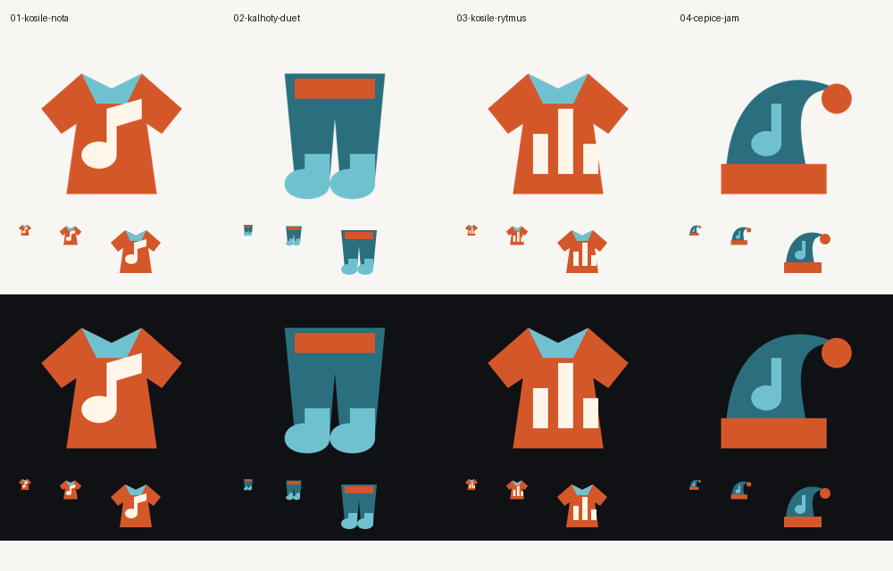

# Koncepty loga PyJam

> Archiv prvního kola. Aktuální vítěz: [druhé kolo — trojúhelníková čepice s notou](kolo2/README.md).

Zadal **Honza dne 2. 11. 2026 přes Clauda** pro veřejný web `R0bbik/pyjam-web`. Návrhy, výběr a ruční SVG zpracoval Codex dne 2. 11. 2026. Zadání: pyžamo/noční košile + hudba, jednoduchý symbol bez textu, nejvýše tři barvy, použitelný v 16 px a 120 × 120 px.

| Koncept | Význam a posouzení | Náhled / zdroj |
| --- | --- | --- |
| **01 – Noční košile s notou (vítěz)** | Výstřih a rozšířený spodní lem odkazují na noční košili; velká nota vyjadřuje jam. Jeden kompaktní obrys, nota čitelná i v 16 px. | [PNG](01-kosile-nota.png) · [SVG](01-kosile-nota.svg) |
| 02 – Pyžamové kalhoty / duet | Nohavice zakončené jako dvě notové hlavičky. Vtipné spojení pyžama a duetu, ale v malém měřítku méně zřejmý oděv. | [PNG](02-kalhoty-duet.png) · [SVG](02-kalhoty-duet.svg) |
| 03 – Rytmická košile | Pyžamové pruhy se mění v hudební úrovně. Souvisejí i s PyJamCore a PyJamOS, hudbu ale vyjadřují méně přímo než nota. | [PNG](03-kosile-rytmus.png) · [SVG](03-kosile-rytmus.svg) |
| 04 – Noční čepice / jam | Čepice s bambulí a notou: noční tvorba. Dobře čitelná silueta, ale nesplňuje motiv košile či pyžama tak přímo. | [PNG](04-cepice-jam.png) · [SVG](04-cepice-jam.svg) |

## Proč vítěz

Nejpřímější spojení Honzova přání a hudebního projektu, bez závislosti na Pythonu či konkrétní kapele. Výstřih, lem a jedna velká nota mají přednost před drobnými knoflíky, švy nebo vzory. Vizuálně porovnáno na barvách webu `#f7f6f3` a `#0f1115`, v 16, 28, 64 a 120 px.

## Finální soubory

- [Symbol](../pyjam-logo.svg), [symbol + ručně kreslený nápis PyJam](../pyjam-logo-text.svg), [favicon](../favicon.svg).
- [Google 120 × 120 PNG](../pyjam-logo-120.png), [512 × 512 PNG](../pyjam-logo-512.png); průhledné pozadí, prostor kolem symbolu je součástí plátna.
- Tři ploché barvy: oranžová `#d4572a`, světlá petrolejová `#6fc1d0`, krémová `#fff5e9`. Stejný symbol pro světlé i tmavé prostředí.
- SVG jsou ručně psané geometrické cesty, bez bitmap, externích písem či závislostí. PNG byly exportovány ze symbolu pomocí CairoSVG. Favicon zachovává totožnou siluetu a barvy.

Neproběhlo nasazení ani změna konfigurace Google OAuth. PNG je připraven k následnému použití vlastníkem projektu.
