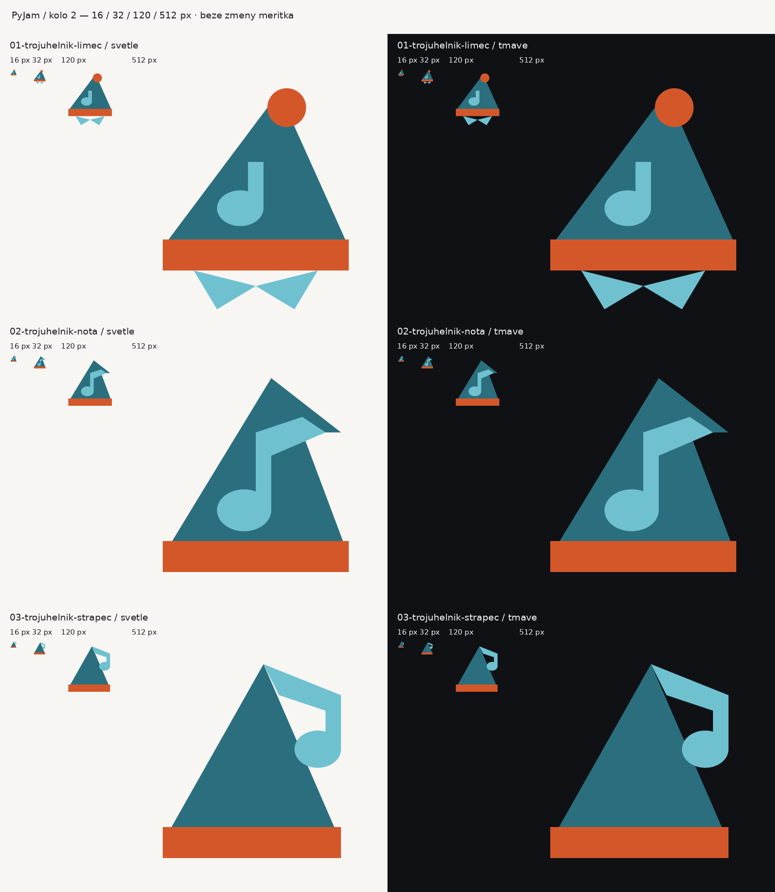

# PyJam — druhé kolo: trojúhelník

Reakce na Honzův komentář v PR #1 a doplnění zadání: dominantní noční čepice, maximální jednoduchost, hlavní tvar trojúhelník. Návrhy a ruční SVG: Codex, 2. 11. 2026. Trojúhelník zde bereme jako výtvarný požadavek; marketingový účinek neposuzujeme.

Přehled obsahuje skutečné pixelové velikosti. Pro posouzení 16 px otevřít originál při 100 %, protože GitHub celý přehled zmenšuje.

| Varianta | Záměr a posouzení | Soubory |
| --- | --- | --- |
| 01 — Trojúhelník a límec | Čepice s bambulí a notou, pod ní jen malý pyžamový límec. Košile je redukována na límec, bez siluety trička. V 16 px límec přidává drobné detaily. | [SVG](01-trojuhelnik-limec.svg) · [PNG](01-trojuhelnik-limec-512.png) |
| **02 — Trojúhelník a nota, vítěz** | Tři ploché prvky: trojúhelníková čepice s přehnutou špičkou, lem a nota. Praporec navazuje na špičku. Spojuje hlavní čepici konceptu 4 s notou konceptu 1. Košile vynechána pro čitelnost v 16 px. | [SVG](02-trojuhelnik-nota.svg) · [PNG](02-trojuhelnik-nota-512.png) |
| 03 — Hudební střapec | Čistý trojúhelník s lemem, nota zastupuje visící střapec. Stejně málo prvků jako 02, ale v 16 px vnější nota méně drží pohromadě s čepicí. | [SVG](03-trojuhelnik-strapec.svg) · [PNG](03-trojuhelnik-strapec-512.png) |

Každá varianta má transparentní PNG v 16/32/120/512 px. Zachována paleta původní čepice (koncept 4): petrolejová `#2b6f7e`, oranžová `#d4572a`, světle petrolejová `#6fc1d0`. Pozadí přehledu: `#f7f6f3` a `#0f1115`.

Vítěz 02 byl vybrán pro kompaktní siluetu a nejčitelnější spojení čepice a hudby v 16 px; v 120 px je zřetelný i přehyb špičky. Bez košile nehrozí dojem trička. Logo zůstává ploché, bez obrysů, stínů a externích písem.

## Finální výstupy

Vítězná 02 nahrazuje [symbol](../../pyjam-logo.svg), [favicon](../../favicon.svg), [symbol s původním ručně kresleným nápisem](../../pyjam-logo-text.svg), [PNG 120](../../pyjam-logo-120.png) a [PNG 512](../../pyjam-logo-512.png). Všechny čtyři HTML stránky odkazují na stejné aktualizované soubory, takže nové logo i favicon přebírají přímo. První kolo je zachováno jako archiv.

Ověření: vizuální kontrola na obou pozadích; XML SVG, přesná shoda faviconu a symbolu, rozměry/průhlednost PNG a jejich shoda s exportem SVG, platnost odkazů z HTML, `git diff --check`. Dočasné soubory `_prace/` odstraněny. Bez sloučení PR a změny OAuth konfigurace.
